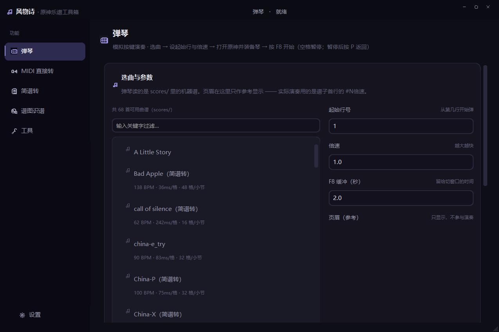
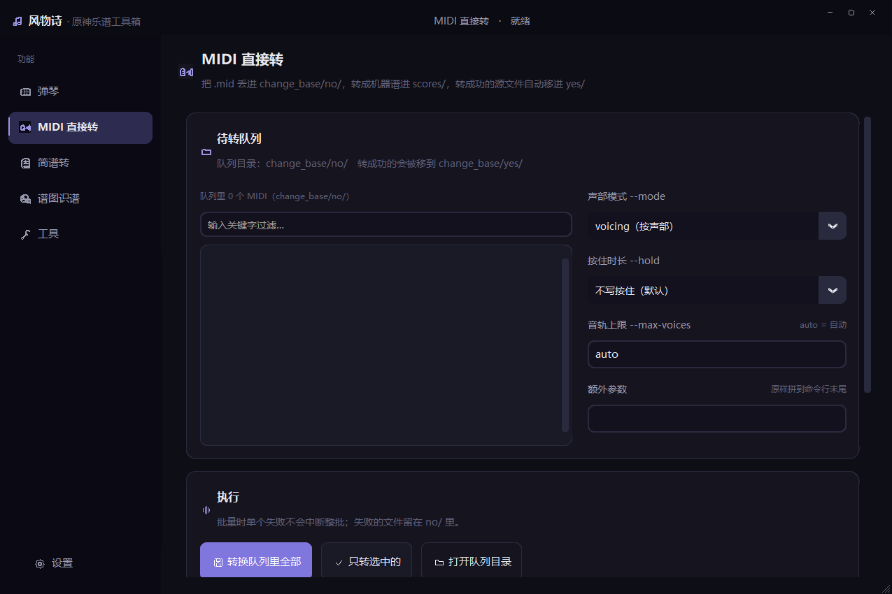
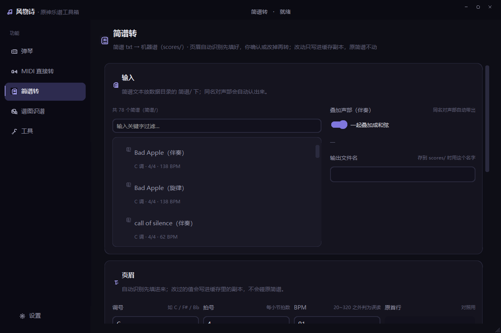
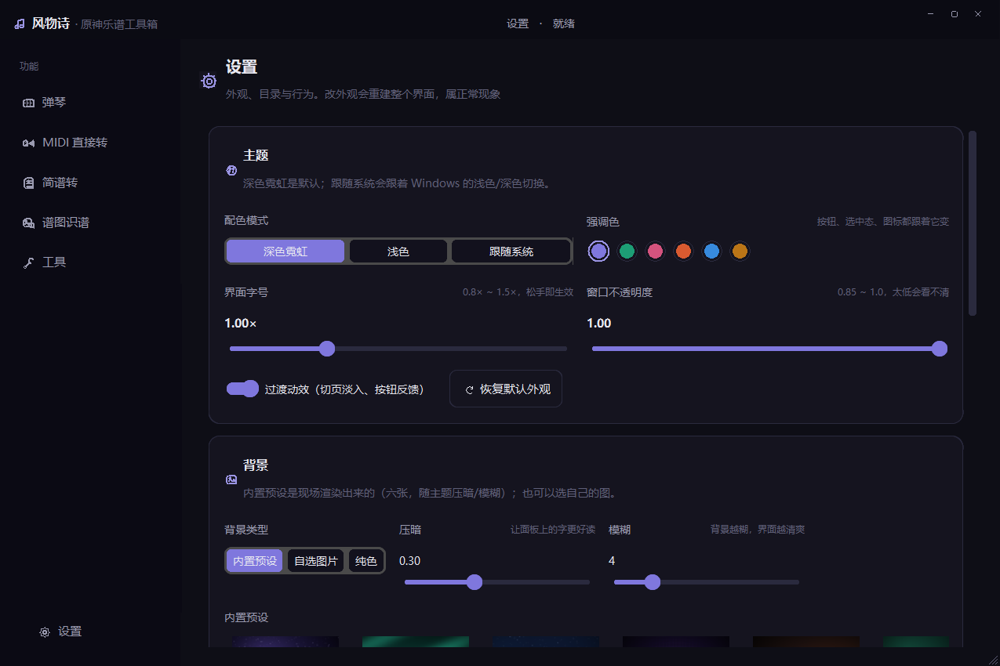

# 风物诗 · 原神乐谱工具箱

> 把原先散落在好几个批处理和命令行里的工具，合成**一个桌面窗口应用**。
> 六页：弹琴 · MIDI 直接转 · 简谱转 · 谱图识谱 · 工具 · 设置。



<details>
<summary>其余五页截图（点击展开）</summary>

| MIDI 直接转 | 简谱转 |
|---|---|
|  |  |

| 谱图识谱 | 工具 |
|---|---|
|  |  |

**设置**（外观全在这里改）



</details>

---

## 一、为什么有这个应用

之前的入口是散的：`弹琴.bat`、`转换.bat`、`识谱WebUI/启动服务.bat`、
以及五六个只能敲命令行的脚本。想转一首谱子得先想清楚「我现在该开哪个」。

`风物诗` 把它们收进一个窗口：

| 原来 | 现在 |
|---|---|
| `弹琴.bat`（命令行选曲） | **弹琴**页：曲目列表 + 搜索 + 起始行/倍速/缓冲 |
| `转换.bat`（整目录批处理） | **MIDI 直接转**页：队列 + 单首/批量 + 参数 |
| `jianpu_to_score.py`（命令行） | **简谱转**页：页眉可改、自动找对声部、预览后落盘 |
| `识谱.py`（命令行，4077 行） | **谱图识谱**页：选图/选目录、按页序、页眉必填 |
| `retime` / `add_hold` / `字母谱转谱` / `字母谱对账` / `verify_original` | **工具**页：下拉选工具 → 填参数 → 跑 → 看日志 |
| 改主题、字号、背景？没有 | **设置**页：主题 / 强调色 / 全局字号 / 背景 / 不透明度 |

**原有的命令行入口一个都没删**：`弹琴.bat`、`转换.bat`、识谱 WebUI 的
`启动服务.bat` 全部保留，照旧可用。这个应用只是**新增**的入口。

---

## 二、安装

### 方式一：安装包（推荐）

下载 `风物诗-安装包-0.1.0.exe` 双击即可。

- 装到 `%LOCALAPPDATA%\Programs\风物诗`，**安装过程不需要管理员权限**，不弹 UAC
- 创建开始菜单项；桌面快捷方式在向导里勾一下（默认不勾）
- 卸载：开始菜单里的「卸载 风物诗」，或运行安装目录下的 `unins000.exe`

> **卸载不会删除你的曲谱数据**（见「数据放在哪」）。重装继续用。

### 方式二：便携版

`风物诗-便携版.zip` 解压到任意目录，双击 `风物诗.exe`。
**不要单独把 exe 拿出来**，它需要同级的 `_internal/`、`获取谱子/`、`parser.py`、`player.py`。

### 方式三：从源码跑

```bash
python -m pip install -r 风物诗/requirements.txt
python 风物诗/main.py
```

源码跑法需要**仓库根目录里有 `获取谱子/`**（应用会自动往上一级找）。

---

## 三、数据放在哪

| 内容 | 位置 |
|---|---|
| 曲谱 / 简谱 / MIDI 队列 / 产物 | `文档\风物诗\` |
| 配置 / 背景缓存 / 识谱中间件 / 日志 | `%LOCALAPPDATA%\风物诗\` |

**首次运行时**，应用会把仓库里现有的 `scores/`、`简谱/`、`change_base/`
**复制一份**到 `文档\风物诗\` 使用 —— **只复制，不移动、不删除、不覆盖**。

> 这是刻意设计的一条硬约束：**仓库里原有的乐谱文件此后不再被写入**。
> 应用产生的新曲谱落在文档目录，要不要同步回仓库，
> 由「设置 → 允许同步回仓库」开关 + **每次点确认**双重把关（默认关闭）。

想换位置，用环境变量：

| 变量 | 作用 |
|---|---|
| `FENGWUSHI_DATA_DIR` | 覆盖数据目录（默认 `文档\风物诗`） |
| `FENGWUSHI_CACHE_DIR` | 覆盖配置/缓存目录（默认 `%LOCALAPPDATA%\风物诗`） |
| `FENGWUSHI_SCRIPTS` | 指定 `获取谱子/` 目录（找不到时会自动查找并提示） |

---

## 四、关于管理员权限：只在弹琴那一刻提权

模拟按键需要管理员权限（原神跑在管理员下，Windows UIPI 会**静默丢弃**低权限进程发来的按键）。

所以本应用**平时以普通权限运行**；只有你点「**开始演奏**」时，它才会
`ShellExecuteW("runas", ...)` **以管理员身份重启一个自己**，把
曲目 / 起始行 / 倍速 / 缓冲通过命令行带过去，重启后自动接着开跑。

```bat
风物诗.exe --play "C:\...\scores\某曲.txt" --start-line 3 --speed 1.25 --delay 4
```

也就是说：UAC 提示只会在「开始演奏」这一个动作出现，用完即退。

---

## 五、六页各自在做什么

### 弹琴
选曲 → 设起始行 / 倍速 / F8 缓冲 → 提权重启 → 按 F8 开始（空格暂停，暂停后 P 返回）。
- 曲目列表读 `文档\风物诗\scores\`，每行带摘要（`138 BPM · 36ms/格 · 48 格/小节`）
- 页眉框**只作参考显示**：真正演奏用的是机器谱首行的 `#N倍速`，与页眉无关

### MIDI 直接转
- 队列读 `文档\风物诗\change_base\no\`，可单首可批量
- 走 `midi_to_score.py` 的**单文件模式 + 显式 `-o`**（脚本自带的批量模式目录写死在仓库里，应用不用它）
- 转成功的 `.mid` 自动移到 `yes/`

### 简谱转
- 调号 / 拍号 / BPM 从简谱 txt **首行**读出，**自动填进页眉输入框**，你可以改
- ⚠️ `jianpu_to_score.py` **没有 `--head` 参数** —— 唯一覆盖口是 `--bpm`。
  所以「手动改页眉」的实现是：在缓存目录写一份**改过首行的副本**再喂给它，
  **原简谱文件一个字都不动**
- 自动识别对声部（`X（旋律）.txt` ↔ `X（伴奏）.txt`），可开关
- 两段式：先 `--dry-run` 出预览，看过再点保存；另有「**直接落盘**」开关

### 谱图识谱
选图 / 选目录 → 按页序排（取文件名里的数字）→ **页眉必填**（本机自动识别失效）→ 跑 → 产物可存进 `简谱/` 与 `scores/`。
- 明确传 `--bass`，不让脚本往当前工作目录丢 `简谱-左手.txt`

### 工具
下拉选工具 → 按脚本真实参数渲染控件 → 跑 → 日志。

| 工具 | 说明 |
|---|---|
| 改时值 `retime.py` | `--base` 是**当初生成这首谱时的 BPM**（脚本会拿它跟头部 `N BPM` 核对），不是格长 |
| 加按住 `add_hold.py` | 已人工维护过第三列的谱子会被跳过，要覆盖得勾 `--force` |
| 字母谱转谱 / 字母谱对账 / 原谱独立复核 | 见仓库根 README 对应章节 |

除 `verify_original.py` 外，工具**默认只试运行**，要写盘得显式勾「真正写回文件」。

### 设置
主题（深色霓虹 / 浅色 / 跟随系统）、强调色、**全局字号 0.8×~1.5×**、
窗口不透明度、过渡动效、背景（**内置预设 / 自选图片 / 纯色** + 压暗 + 模糊）、
数据与路径、默认页眉、同步回仓库开关、依赖自检、配置存储自检、导出自检报告。

> ⚠️ CustomTkinter **不支持运行时热换肤** ⇒ 改外观是**整棵树销毁重建**，
> 你会看到界面闪一下，属正常现象。

---

## 六、架构

```
风物诗/
├── main.py                   入口：--page / --play / --selftest / --shots …
├── 打包.bat                  【双击】一键打包（薄壳，逻辑在 tools/build.py）
├── 风物诗.spec               PyInstaller onedir 配置
├── 安装包.iss                Inno Setup 脚本
├── 打包说明.md               打包流程与配置取舍
├── 使用须知.txt              安装前展示给用户的须知
├── requirements.txt
├── assets/                   图标（代码画）+ 截图
├── tools/
│   ├── build_icon.py         生成 assets/风物诗.ico（7 个尺寸）
│   └── build.py              打包：PyInstaller → 装配素材 → zip → Inno
└── app/
    ├── paths.py              路径契约 + write_text（原子/降级写盘）
    ├── settings.py           配置读写（失败不静默）
    ├── theme.py              外观参数 → 颜色/字体 token（单一入口）
    ├── backgrounds.py        6 张预设背景现场渲染（不往仓库塞图）
    ├── icons.py              23 个纯 Canvas 矢量线性图标
    ├── widgets.py            自绘标题栏 / 导航 / 卡片 / 日志视图 / 自拼图标按钮
    ├── picker.py             带搜索过滤的列表选择器
    ├── runner.py             进程内调脚本 + 抓 stdout + 单飞锁 + 落盘日志
    ├── toolchain.py          界面输入 → argv，文件 → 摘要
    ├── selfcheck.py          自检报告（打包验证 + 用户排障）
    ├── window.py             主窗口：背景层 / 导航 / 页面栈 / 提权重启
    └── pages/                base + 六页
```

### 关键设计：**进程内调用工具脚本，不起子进程**

打包成 exe 后 `sys.executable` 就是 exe 自己，跑不了 `.py`。所以项目用
`importlib.util.spec_from_file_location()` **就地加载**工具脚本，
再用 `contextlib.redirect_stdout` 抓输出。

⚠️ 两个必须注意的点：
1. 加载后**必须** `sys.modules[name] = mod` 先注册，否则脚本里的
   `@dataclass` 解析注解时会崩；
2. stdout 是**进程级**的 ⇒ 必须有单飞锁（`Runner` 里已加），否则两个任务会串台。

### 关键设计：**工具脚本必须躺在 exe 旁边**

工具脚本是**运行时被就地加载的普通文件**，不是被编译进 exe 的。它们各自按
`__file__` 反推仓库根去找 `parser.py`：

```
风物诗\                     ← exe 所在处 = 应用眼里的「仓库根」
    风物诗.exe
    _internal\              ← Python 运行时与第三方包
    获取谱子\               ← 应用按 <exe目录>\获取谱子 找它
        jianpu_to_score.py  midi_to_score.py  retime.py  add_hold.py
        verify_original.py  字母谱转谱.py  字母谱对账.py
        简谱识谱\ 识谱.py  imgio.py  audit.py  字模.json
    parser.py  player.py
```

好处：**你可以自己改脚本而不用重新打包**，改完直接生效。

---

## 七、自己打包（面向维护者）

```bat
打包.bat                  打包 exe 并装配可运行目录
打包.bat --clean --inno --zip    清干净 + 出安装包 + 出便携 zip
```

前置：

```bash
python -m pip install -r 风物诗/requirements.txt
python -m pip install pyinstaller
winget install --id JRSoftware.InnoSetup        # 只有打安装包才需要
```

产物：`dist/风物诗/`（可运行目录）、`dist/风物诗-便携版.zip`、`dist/installer/风物诗-安装包-0.1.0.exe`。

细节、以及几处刻意的配置取舍（为什么 onedir / 为什么不 UPX / 为什么安装不要求管理员），
见 [`打包说明.md`](打包说明.md)。

### 出问题先跑自检

```
风物诗.exe --selftest 报告.txt
```

或「设置 → 导出自检报告」。报告会摊开运行环境、依赖、各目录、工具脚本是否存在、
配置能否落盘 —— 排查时直接把这个文件发出来即可。
仓库里存了一份打包后的样例：[`assets/截图/自检报告-打包后.txt`](assets/截图/自检报告-打包后.txt)。

---

## 八、实测证据

| 链路 | 结果 |
|---|---|
| 简谱转 | 退出码 0 / 1296 格 = 874 发声 + 422 休止 / **模拟播放零迟到** / `--dry-run` 未误写产物 |
| 弹琴提权 | 命令行四个参数齐全，接收端回填正确并自动开跑 |
| MIDI 直接转 | 退出码 0 / 产物 1335 行 / 独立复核「全部通过 ✓」/ 转完移入 `yes/` |
| 谱图识谱 | 9.4 秒 / 退出码 0 / 乐理自检「每小节拍数 = 4，48 小节·声部 **0 错**」/ 仓库与工作目录**零意外写入** |
| 工具页 | 独立复核 ✓、加按住 ✓（已带第三列的谱子正确跳过） |
| 外观系统 | 4 组档案之间 9~14 项控件属性真实变化（**程序化核查**，不靠截图） |
| 打包后 exe | `frozen=True`、`获取谱子` 与 `parser.py`/`player.py` 都在同级找到、配置试写通过 |
| 安装包 | 静默安装退出码 0、`Installation process succeeded`、1051 文件 / 72.6 MB、开始菜单两个 `.lnk` 齐全 |

---

## 九、已知限制

- **弹琴只在 1920×1080 逻辑分辨率下按原神默认键位假设工作**，与原来的 `弹琴.bat` 行为一致，未做改动。
- 页眉**自动识别**在本机不可靠（46 首里只有 1 首能自动认出）⇒ 识谱页把页眉设为**必填**。
- `retime.py` 的 `--base` 必须与曲谱头部 `N BPM` 一致，否则脚本会直接报错（这是它的防呆，不是 bug）。
- 「同步回仓库」默认关闭；打开后每次写入仍需你点确认。
- 本应用不修改 `获取谱子/` 下的任何脚本；工具脚本的缺陷要直接改那批脚本。

---

## 十、许可

与仓库根 `README.md` 一致。
